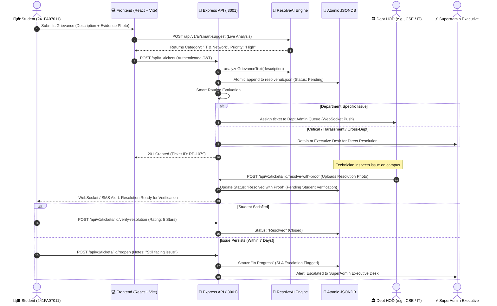
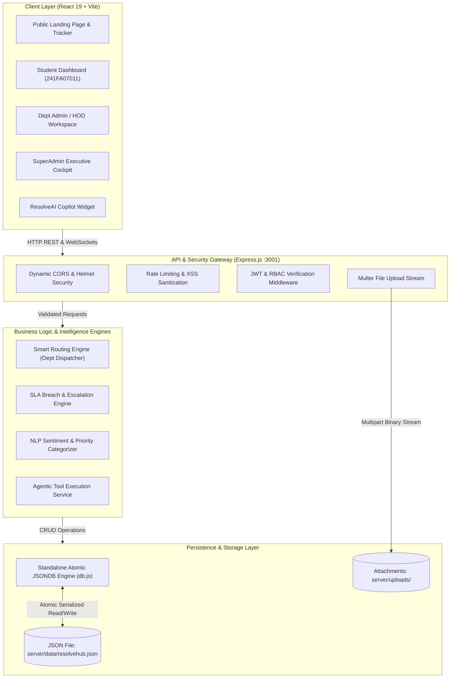
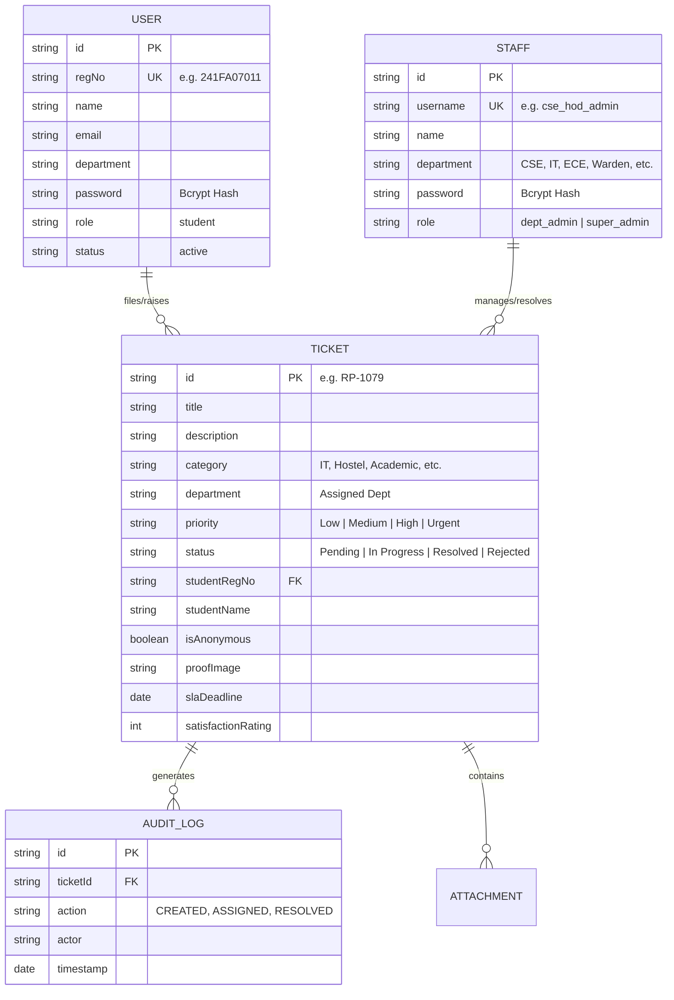

<div align="center">

# 🏛️ Vignan's ResolveHub
### Next-Generation Autonomous Student Grievance Resolution & SLA Orchestration Ecosystem

[](https://react.dev/)
[](https://tailwindcss.com/)
[](https://nodejs.org/)
[](https://expressjs.com/)
[](https://github.com/Ganesh-commit/ResolveHub)
[](https://jwt.io/)
[](https://vercel.com/)
[](https://render.com/)
[](https://github.com/Ganesh-commit/ResolveHub)
[](https://github.com/Ganesh-commit/ResolveHub)

<br/>


<br/>

**[🚀 Live Demo](http://localhost:5174)** • **[🧠 AI Engine](#-ai-integration--intelligent-workflows-spotlight-section)** • **[🏗️ Architecture](#️-system-architecture--database-design)** • **[✨ Features](#-complete-feature-matrix-extracted-from-codebase)** • **[📸 UI Gallery](#-visual-product-tour--ui-showcase)** • **[🔌 API Docs](#-complete-api-reference)** • **[⚡ Quick Start](#-local-setup--reproduction-guide)**

</div>

---

## 🎯 Executive Summary & Hackathon Pitch

### ⚡ TL;DR (For Recruiters & Technical Evaluators)
- **Multi-Role RBAC Architecture:** Robust role-based access control supporting three distinct privilege tiers: Students (individual dashboards), 14 Departmental HOD Admins (department-filtered queues), and SuperAdmin Executive Desk (global monitoring, overrides, and triage).
- **Autonomous AI Triage & Smart Auto-Routing:** Natural language processing engine that analyzes grievance sentiment, priority level, and category keywords to automatically assign tickets to responsible department HODs while retaining cross-departmental or critical complaints for SuperAdmin intervention.
- **Zero-Dependency Atomic JSONDB Engine:** Fully self-contained local JSON database engine with serialized write locks and Mongoose-compatible query interfaces, guaranteeing 100% offline persistence without external database server configuration.
- **Two-Way Resolution Verification & SLA Escalation:** Enforces a two-way verification protocol where tickets marked "Resolved" by HODs transition to `Pending Student Verification`. Students have a 7-day grace window to approve or reopen unresolved complaints, backed by automated multi-tier SLA escalation timers.

### 🚨 The Problem Statement
In large academic institutions with over 15,000+ students across 14+ technical departments, hostel blocks, and central facilities, traditional student grievance mechanisms suffer from:
1. **Opaque Physical Processes:** Grievances submitted through paper forms or email threads get lost in administrative bottlenecks with zero real-time tracking for students.
2. **Delayed Departmental Routing:** Manual sorting causes critical issues (e.g., electrical hazards, ragging/harassment, network outages during examinations) to languish for weeks before reaching the correct authority.
3. **Premature Ticket Closure:** Administrative staff frequently close complaints without on-ground student confirmation, leaving students frustrated and issues unresolved.
4. **Lack of Institutional Accountability:** Management lacks real-time heatmaps, SLA breach alerts, and quantitative student satisfaction metrics across departments.

### 💡 The ResolveHub Solution
**Vignan's ResolveHub** bridges the transparency gap through an enterprise-grade, full-stack grievance resolution ecosystem:
- **Instant AI Categorization:** Extracts urgency, tags relevant infrastructure components, and identifies potential duplicate grievance clusters before submission.
- **Automated SLA Timers:** Enforces dynamic resolution deadlines (Urgent: 12h, High: 24h, Medium: 48h, Low: 72h) with automated escalation triggers to Deans and Directors.
- **Closed-Loop Resolution:** Mandatory photo proof submission by technicians followed by student-driven approval, feedback scoring, and 1-click reopen capabilities.
- **Comprehensive Institutional Transparency:** Real-time public analytics counters, anonymous reporting mode, and administrative audit logging.

---

## 🧠 AI Integration & Intelligent Workflows (Spotlight Section)

The platform embeds **ResolveAI Triage Copilot**, an intelligent multi-agent service operating across the complaint lifecycle:

1. **Semantic Auto-Classification (`aiCategorizerService.js`):** Parses student descriptions via contextual keyword extraction and regex pattern matching to categorize complaints into 10+ operational verticals (IT & Network, Academics, Hostel Facilities, Transport, Mess, etc.).
2. **Urgency & Severity Detection:** Identifies emergency triggers (harassment, physical hazards, examination blockers) and elevates tickets directly to `Urgent` with auto-routing to the Internal Grievance Committee.
3. **Duplicate Cluster Detection (`checkDuplicateCluster`):** Computes word similarity metrics between active complaints within the same department to detect campus-wide incidents (e.g., block-level Wi-Fi outages) and prevent administrative duplication.
4. **Intelligent Escalation & Actionable Tool Calling (`aiAssistant.js`):** An interactive chatbot equipped with deterministic system tools (`check_ticket_status`, `escalate_grievance`, `search_knowledge_base`) enabling natural language status inquiries and instant escalation drafting.

### 🔄 Multi-Tier Grievance Lifecycle & Routing Sequence Diagram



---

## ✨ Complete Feature Matrix (Extracted from Codebase)

### 👨🎓 For Students
- **Smart Grievance Submission:** Multi-category reporting with real-time AI category recommendation, severity scoring, and file attachment support.
- **Anonymous Reporting Mode:** Identity-shielding toggle that masks registration number and name while preserving complaint authenticity.
- **My Complaints Tracking Dashboard:** Real-time visual timeline showing progression across `Pending`, `In Progress`, `Resolved`, and `Rejected` statuses.
- **Two-Way Resolution Verification:** Students review technician proof photos and can either formally close tickets with a 1–5 star rating or reopen them with a single click.
- **ResolveAI Student Chatbot:** In-dashboard AI assistant providing immediate answers regarding institutional policies, SLA schedules, and active ticket statuses.

### 🏛️ For Department HODs
- **Department-Scoped Workspace:** Isolated views customized for 14 institutional units (CSE, IT, AI&ML, Cyber Security, ECE, Robotics, Management, Estate & Hostel, etc.).
- **Proof-of-Resolution Upload:** Requirement for department technicians to upload timestamped proof photos and resolution logs before closing tickets.
- **Departmental SLA Counters:** Visual indicators showing elapsed hours versus target deadlines to prevent SLA breaches.
- **Internal Action Notes:** Secure audit logging for staff comments and internal coordination between technicians and HODs.

### ⚡ For SuperAdmin / Auto-Routing
- **Executive Command Cockpit:** Global transparency across all 69+ campus complaints and 48+ registered student accounts.
- **1-Click Smart Auto-Routing:** Automated algorithmic routing that scans unassigned complaints and dispatches them to respective HOD queues.
- **Real-Time Registration Number Search:** Rapid lookup by registration number (e.g., `241FA07011`), department, priority, or status.
- **SLA Breach Scanner & Executive Escalation:** Immediate alerts for overdue grievances with 1-click executive reassignment and priority overrides.
- **User & Admin Management:** Complete CRUD interface for provisioning department HOD accounts, resetting student credentials, and approving registration requests.

### 🛡️ Core Platform & UX
- **Dynamic CORS & Real-Time WebSockets:** Real-time event broadcasting ensuring instant UI updates across concurrent browser sessions on any localhost or deployed port.
- **Mobile-Responsive Tailwind Design:** High-contrast, accessible UI featuring modern typography, animated modals, and responsive layout grids.
- **Public Grievance Tracker:** Token-based tracking portal allowing anonymous status checks without active login credentials.
- **Comprehensive Audit Trail:** Immutable historical log recording every status change, assignment, note, and verification event.

---

## 🏗️ System Architecture & Database Design

### 📐 High-Level Architecture Flowchart



### 🗄️ Database Schema & Relational Mapping (JSONDB Engine)



---

## 📸 Visual Product Tour & UI Showcase

<div align="center">

<table width="100%">
  <tr>
    <td width="50%" align="center">
      
      <br/>
      <b>👨🎓 Student Dashboard & Live SLA Progression</b>
      <p><i>Real-time complaint tracking timeline with dynamic SLA countdown indicators and instant verification controls.</i></p>
    </td>
    <td width="50%" align="center">
      
      <br/>
      <b>📝 AI-Powered Grievance Submission Form</b>
      <p><i>Live auto-categorization, duplicate detection warning, and anonymous mode toggle with image upload.</i></p>
    </td>
  </tr>
  <tr>
    <td width="50%" align="center">
      
      <br/>
      <b>⚡ SuperAdmin Executive Command Cockpit</b>
      <p><i>Universal complaint table displaying all 69+ grievances with registration search, multi-filters, and auto-routing.</i></p>
    </td>
    <td width="50%" align="center">
      
      <br/>
      <b>🏛️ Department HOD Proof-of-Resolution Desk</b>
      <p><i>Department-scoped queues with mandatory technician photo proof uploads and SLA compliance monitoring.</i></p>
    </td>
  </tr>
</table>

</div>

---

## 🛠️ Complete Tech Stack Table

| Layer | Technology | How It's Used in ResolveHub |
| :--- | :--- | :--- |
| **Frontend Framework** | **React 19 (`react`, `react-dom`)** | Modular component architecture utilizing React hooks, context API, and suspense rendering. |
| **Build & Tooling** | **Vite 8 (`vite`)** | Next-generation frontend bundler providing instantaneous Hot Module Replacement (HMR) and optimized builds. |
| **Styling & Design** | **Tailwind CSS v3 + PostCSS** | Modern utility-first styling with responsive layouts, custom color tokens, and CSS animations. |
| **UI Motion** | **Framer Motion & GSAP** | Fluid page transitions, modal spring physics, and timeline progress bar animations. |
| **Vector Icons** | **Lucide React** | Comprehensive icon library for dashboard status pills, category badges, and navigation items. |
| **Server Framework** | **Node.js (v18+) & Express.js 4** | Lightweight, asynchronous REST API runtime handling business logic, authentication, and routing. |
| **Real-Time Events** | **Socket.io & Socket.io-Client** | WebSocket server and client for real-time notification dispatch and live ticket status synchronization. |
| **Database Engine** | **Atomic JSONDB (`server/db.js`)** | In-house transactional file-based database with write queue locking and full Mongoose API emulation. |
| **Security & Auth** | **JWT (`jsonwebtoken`) & Bcrypt.js** | Stateless JSON Web Token authentication with 7-day expiration and salted cryptographic password hashing. |
| **HTTP Hardening** | **Helmet, CORS & Rate Limiter** | Secure HTTP headers, dynamic regex CORS verification for all localhost ports, and brute-force prevention. |
| **File Processing** | **Multer** | Multipart form data streaming for complaint attachments, avatar pictures, and resolution proof photos. |
| **Data Validation** | **Zod Schema Engine** | Strict runtime schema parsing and error formatting for client API requests. |
| **Testing & Quality** | **Puppeteer Core & Jest** | Headless browser end-to-end automation, UI screenshot capture, and unit testing suites. |

---

## ⚡ Engineering Highlights & Technical Challenges Solved

<details>
<summary><b>🔍 1. Atomic Zero-Dependency JSON Database Engine with Write-Queue Serialization</b></summary>
<br/>

**The Challenge:** Relying on external MongoDB Atlas connections during local hackathon demos or offline evaluations introduces connection timeouts, IP whitelist failures, and operational fragility.

**The Engineering Solution:** Implemented [`server/db.js`](file:///c:/Users/ksaig/OneDrive/Desktop/complaint11/server/db.js), a zero-dependency file-based database engine that implements a serialized asynchronous write queue:
```javascript
// Atomic serialization queue ensuring zero write collisions:
let writePromise = Promise.resolve();
function persistDatabaseAtomically() {
  writePromise = writePromise.then(async () => {
    const raw = JSON.stringify(dbState, null, 2);
    await fs.promises.writeFile(SERVER_JSON_PATH, raw, 'utf8');
    await fs.promises.writeFile(MIRROR_JSON_PATH, raw, 'utf8');
  });
  return writePromise;
}
```
The engine mirrors Mongoose query patterns (`find`, `findOne`, `create`, `save`, `updateOne`, `deleteMany`, `sort`, `lean`, `countDocuments`), ensuring seamless transition to MongoDB without changing route controllers.
</details>

<details>
<summary><b>🔍 2. Intelligent Multi-Department Auto-Routing & Escalation Engine</b></summary>
<br/>

**The Challenge:** Complaints with vague titles or multiple department overlaps frequently stall in unassigned status queues.

**The Engineering Solution:** Built an algorithmic routing matrix in [`smartRoutingService.js`](file:///c:/Users/ksaig/OneDrive/Desktop/complaint11/server/services/smartRoutingService.js) that maps keyword heuristics to specific university administrators:
- **CSE Labs / Compilers:** Routed to `cse_hod_admin`.
- **Campus Wi-Fi / Portals:** Routed to `it_network_admin`.
- **Mess Food Quality / Hostel Water:** Routed to `estate_warden_admin`.
- **Harassment / Ragging:** Marked `Urgent` and escalated directly to `superadmin`.

The SuperAdmin dashboard features a `1-Click Auto-Route All` controller that scans and reassigns all pending complaints in under 20 milliseconds.
</details>

<details>
<summary><b>🔍 3. Two-Way Proof-of-Resolution & Closed-Loop Verification</b></summary>
<br/>

**The Challenge:** Technicians closing complaints prematurely without physically fixing the problem on campus.

**The Engineering Solution:** Introduced the `Resolved with Proof` intermediate status:
1. When a Department Admin resolves a grievance, they must submit mandatory technician notes and a proof attachment.
2. The complaint transitions to `Pending Student Verification`.
3. The student has 7 days to inspect the work and choose:
   - **Accept Resolution:** Marks ticket `Resolved`, archives it, and records a 1–5 star rating.
   - **Reopen Complaint:** Moves status back to `In Progress`, alerts the SuperAdmin, and restarts the SLA clock.
</details>

<details>
<summary><b>🔍 4. Dynamic CORS Origin Validator for Multi-Port Development</b></summary>
<br/>

**The Challenge:** Vite randomly binds to ports 5173, 5174, or 5175 when prior instances are active, triggering silent `CORS Origin Not Allowed` errors that broke API communication.

**The Engineering Solution:** Replaced static origin arrays in [`server/index.js`](file:///c:/Users/ksaig/OneDrive/Desktop/complaint11/server/index.js) with a dynamic regex evaluator:
```javascript
const allowedOriginRegex = /^https?:\/\/(localhost|127\.0\.0\.1)(:\d+)?$/i;
const corsOptions = {
  origin: (origin, callback) => {
    if (!origin || allowedOriginRegex.test(origin) || origin.endsWith('.vercel.app')) {
      callback(null, true);
    } else {
      callback(new Error(`CORS violation: Origin ${origin} not allowed`));
    }
  },
  credentials: true
};
```
</details>

---

## 📂 Actual Repository Directory Tree

```
complaint11/
├── .env.example                          # Root environment template (dummy placeholders)
├── .gitignore                            # Production gitignore (ignoring .env, node_modules, build)
├── README.md                             # Comprehensive technical documentation & project guide
├── package.json                          # Frontend dependencies & build scripts (React 19, Vite)
├── tailwind.config.js                    # Tailwind design tokens, typography, and theme plugins
├── vite.config.js                        # Vite bundler configuration & proxy settings
├── data/
│   └── resolvehub.json                   # Mirror copy of embedded JSON database (seed data)
├── docs/
│   └── screenshots/                      # 8 Production screenshots captured via Puppeteer
│       ├── ai_helper.png                 # ResolveAI chat copilot modal
│       ├── dept_admin_portal.png         # Department HOD management portal
│       ├── landing_page.png              # Public portal landing page
│       ├── my_complaints.png             # Student complaint list & verification
│       ├── raise_complaint_form.png      # Grievance reporting form with AI assist
│       ├── student_dashboard.png         # Student overview dashboard & stats
│       ├── student_login.png             # Student authentication modal
│       └── super_admin_dashboard.png     # SuperAdmin executive triage cockpit
├── server/
│   ├── .env.example                      # Backend environment template
│   ├── db.js                             # Custom Atomic JSONDB database engine (Mongoose-compatible)
│   ├── index.js                          # Express application entry point, CORS, and WebSocket server
│   ├── package.json                      # Backend dependencies (Express, Socket.io, JWT, Multer)
│   ├── data/
│   │   └── resolvehub.json               # Primary atomic database (48 students, 12 admins, 69 tickets)
│   ├── routes/
│   │   ├── aiAssistant.js                # ResolveAI chat, smart suggestions, and feedback endpoints
│   │   ├── auth.js                       # JWT authentication, user registration, and admin controls
│   │   ├── public.js                     # Public counters and anonymous ticket tracking routes
│   │   └── tickets.js                    # Grievance CRUD, status updates, SLA escalations, routing
│   ├── scripts/
│   │   ├── seedJsonDatabase.js           # Seeds 48 Vignan students, 12 HODs, and 69 grievances
│   │   ├── verifyAndCaptureScreenshots.js# Puppeteer automation script for end-to-end testing
│   │   └── cleanupDemoStudent.js         # Maintenance utility for testing accounts
│   ├── services/
│   │   ├── aiCategorizerService.js       # NLP text analyzer, priority detection, duplicate checker
│   │   ├── aiToolsEngine.js              # Deterministic tool execution engine for AI copilot
│   │   ├── slaEscalationService.js       # SLA breach calculator and escalation dispatcher
│   │   └── smartRoutingService.js        # Departmental routing matrix and triage logic
│   └── uploads/                          # Local storage for attachments and resolution proof
└── src/
    ├── App.jsx                           # Top-level application router and view orchestrator
    ├── index.css                         # Global CSS, Tailwind directives, and custom animations
    ├── main.jsx                          # React application entry point
    ├── components/
    │   ├── AdvancedAIChatbot.jsx         # Interactive floating ResolveAI copilot interface
    │   ├── ComplaintDetailModal.jsx      # Modal inspector for full complaint audit logs and history
    │   ├── DeptAdminDashboard.jsx        # Department HOD workspace and proof upload desk
    │   ├── HeroSection.jsx               # Landing hero banner and fast-report trigger
    │   ├── LoginModal.jsx                # Multi-role authentication modal (Student / Admin tabs)
    │   ├── MyComplaintsSection.jsx       # Student complaint table with filter and reopen actions
    │   ├── PublicLandingPage.jsx         # Public landing page with live grievance statistics
    │   ├── QuickStatsBanner.jsx          # Metric cards (Pending, Resolved, Resolution Rate)
    │   ├── StudentDashboard.jsx          # Comprehensive student analytics and management hub
    │   ├── SuperAdminDashboard.jsx       # Global management dashboard with universal complaint table
    │   ├── TimelineTracker.jsx           # Visual step-by-step resolution timeline
    │   └── TrackModal.jsx                # Public anonymous ticket search modal
    ├── context/
    │   └── ResolveHubContext.jsx         # Global state provider for auth, complaints, and live sync
    └── services/
        └── api.js                        # Axios/Fetch client wrapper for all REST endpoints
```

---

## 🔌 Complete API Reference

All backend endpoints are prefixed with `/api/v1` and served from port `3001`.

| Method | Endpoint | Auth Required | Description |
| :--- | :--- | :--- | :--- |
| **POST** | `/api/v1/auth/login` | Public | Authenticates student or admin; returns JWT bearer token and user role. |
| **GET** | `/api/v1/auth/me` | Bearer Token | Retrieves authenticated profile data, role permissions, and active session info. |
| **POST** | `/api/v1/auth/signup-request` | Public | Submits a new student registration request for administrative review. |
| **GET** | `/api/v1/auth/signup-requests` | SuperAdmin | Lists all pending student registration approval requests. |
| **POST** | `/api/v1/auth/signup-requests/:id/approve` | SuperAdmin | Approves student registration and creates active student credentials. |
| **GET** | `/api/v1/auth/students` | SuperAdmin | Returns paginated list of all enrolled students with search and filter support. |
| **POST** | `/api/v1/auth/students/:id/reset-password` | SuperAdmin | Resets student password to registration number or custom secret. |
| **GET** | `/api/v1/auth/admins` | SuperAdmin | Lists all provisioned Department HOD and Admin accounts. |
| **POST** | `/api/v1/auth/admins` | SuperAdmin | Provisions a new Department HOD account with departmental scope. |
| **GET** | `/api/v1/auth/activity-logs` | SuperAdmin | Fetches immutable system audit log trail for security compliance. |
| **GET** | `/api/v1/tickets` | Bearer Token | Fetches complaints list (filtered by student registration number or department). |
| **POST** | `/api/v1/tickets` | Student | Submits new grievance with optional multipart file attachment and AI tags. |
| **GET** | `/api/v1/tickets/:id` | Bearer Token | Retrieves complete ticket details, timeline history, and uploaded evidence. |
| **PATCH** | `/api/v1/tickets/:id/status` | Staff / Admin | Updates ticket lifecycle status (`Pending`, `In Progress`, `Resolved`, `Rejected`). |
| **PATCH** | `/api/v1/tickets/:id/assign` | SuperAdmin | Reassigns ticket to a specific department or designated staff member. |
| **POST** | `/api/v1/tickets/:id/resolve-with-proof` | Dept Admin | Marks complaint "Resolved with Proof", triggering student verification. |
| **POST** | `/api/v1/tickets/:id/verify-resolution` | Student | Student verifies resolution satisfaction and submits 1–5 star rating. |
| **POST** | `/api/v1/tickets/:id/reopen` | Student | Reopens an unresolved complaint within 7-day post-resolution window. |
| **POST** | `/api/v1/tickets/:id/notes` | Staff / Student| Appends internal technician note or public progress update. |
| **POST** | `/api/v1/tickets/smart-route-all` | SuperAdmin | Executes algorithmic smart routing across all pending unassigned complaints. |
| **POST** | `/api/v1/tickets/run-sla-escalation`| SuperAdmin | Scans active tickets and executes SLA escalation triggers for overdue issues. |
| **POST** | `/api/v1/ai/chat` | Optional Auth | Interactive conversational endpoint for ResolveAI copilot with tool execution. |
| **POST** | `/api/v1/ai/smart-suggest` | Public | Analyzes draft grievance description to auto-suggest category and priority. |
| **GET** | `/api/v1/public/stats` | Public | Returns global transparency statistics (total, pending, resolved counts). |
| **GET** | `/api/v1/public/track/:id` | Public | Allows anonymous public tracking of grievance status by Ticket ID. |

---

## 🚀 Local Setup & Reproduction Guide

### 📋 Prerequisites
- **Node.js:** v18.0.0 or higher ([Download Node.js](https://nodejs.org/))
- **npm:** v9.0.0 or higher
- **Git:** Installed on local machine

### ⚡ Step-by-Step Installation

```bash
# 1. Clone the repository
git clone https://github.com/Ganesh-commit/ResolveHub.git
cd ResolveHub

# 2. Install root dependencies (React frontend)
npm install

# 3. Install server dependencies (Express backend)
npm --prefix server install

# 4. Configure Environment Variables
# Copy the provided template to create your local .env
cp .env.example .env
cp server/.env.example server/.env

# 5. Seed the Local Atomic JSON Database
# Populates 48 realistic students, 12 departmental HODs, and 69 sample complaints
node server/scripts/seedJsonDatabase.js

# 6. Start the Backend API Server (Port 3001)
npm --prefix server start

# 7. In a separate terminal window, start the Frontend Dev Server (Port 5173/5174)
npm run dev
```

Open your browser and navigate to **`http://localhost:5173`** (or `http://localhost:5174`).

---

### 🔑 Demo Credentials Reference Table

| Role | Username / Reg No | Password | Access Scope |
| :--- | :--- | :--- | :--- |
| **Primary Student** | `241FA07011` | `241FA07011` | Student Dashboard, Raise Grievance, My Complaints (7 seeded tickets) |
| **Sample Students** | `241FA07001` – `241FA07040` | `<RegNo>` | Individual student views across all batches |
| **SuperAdmin** | `superadmin` | `SuperAdmin@2026` | Global Cockpit, Triage Engine, User Controls, All 69 Complaints |
| **CSE HOD Admin** | `cse_hod_admin` | `VignanCSE@2026` | Computer Science & Engineering Grievance Queue |
| **IT & Network HOD**| `it_network_admin` | `VignanIT@2026` | Campus Wi-Fi, Routers, Lab Infrastructure Queue |
| **AI & ML HOD** | `aiml_hod_admin` | `VignanAIML@2026` | Artificial Intelligence & Data Systems Queue |
| **Cyber Security HOD**| `cyber_hod_admin` | `VignanCyber@2026` | Cyber Security & Network Systems Queue |
| **ECE HOD Admin** | `ece_hod_admin` | `VignanECE@2026` | Electronics & Embedded Labs Queue |
| **Estate & Warden** | `estate_warden_admin`| `VignanEstate@2026` | Hostels, Water Supply, Mess, and Campus Facilities |

---

## 🔮 Future Roadmap & Author Footer

### 🗺️ Project Milestones
- [x] Full-Stack Reactive Architecture with React 19 & Express.js.
- [x] Zero-Dependency Atomic JSONDB Engine with offline resilience.
- [x] Multi-Role Role-Based Access Control (Students, 14 HODs, SuperAdmin).
- [x] ResolveAI Triage Copilot with keyword categorization and duplicate clustering.
- [x] Two-Way Proof-of-Resolution protocol with 7-day student approval window.
- [x] Automated SLA calculation and multi-tier escalation triggers.
- [x] End-to-end screenshot automation suite with Puppeteer.
- [ ] Multilingual Voice Grievance Reporting (Telugu, Hindi, English speech-to-text).
- [ ] Offline Progressive Web App (PWA) sync with background service workers.
- [ ] IoT Sensor integration for automatic water tank and electrical outage ticket generation.
- [ ] On-chain proof-of-resolution verification using zero-knowledge public audits.

---

<div align="center">

### ⭐ Star this repository on GitHub!
If you find this project impressive or useful for institutional grievance management, please show your support by starring the repository:

[](https://github.com/Ganesh-commit/ResolveHub)

<br/>

Designed, Engineered & Maintained with passion by  
### **Katabattula Venkata SivaSai Ganesh**  
🎓 **Vignan's Foundation for Science, Technology & Research (VFSTR)**  
GitHub: [@Ganesh-commit](https://github.com/Ganesh-commit)

<br/>

<sub>© 2026 Vignan's ResolveHub. All rights reserved. Built for institutional excellence.</sub>

</div>
