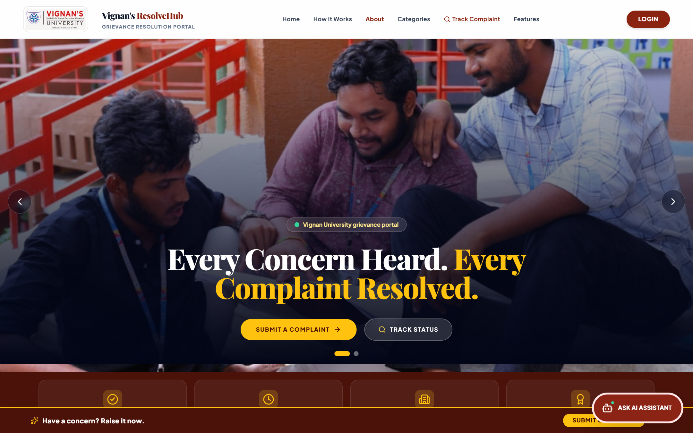
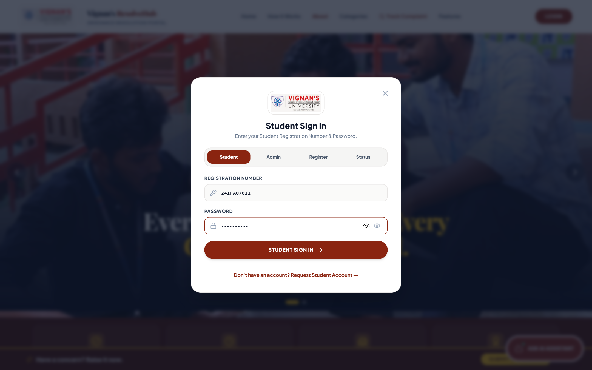
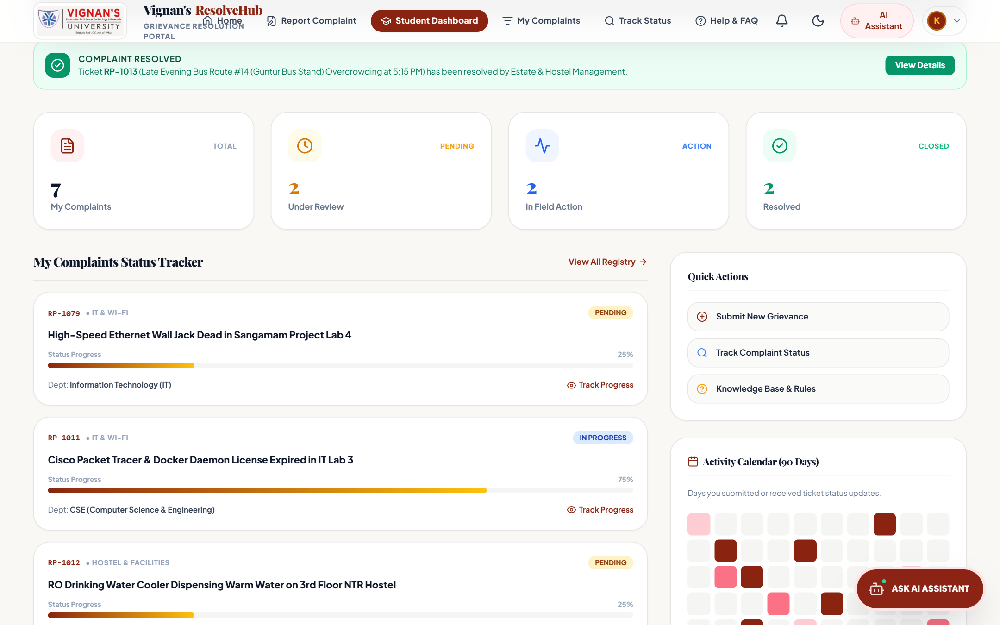
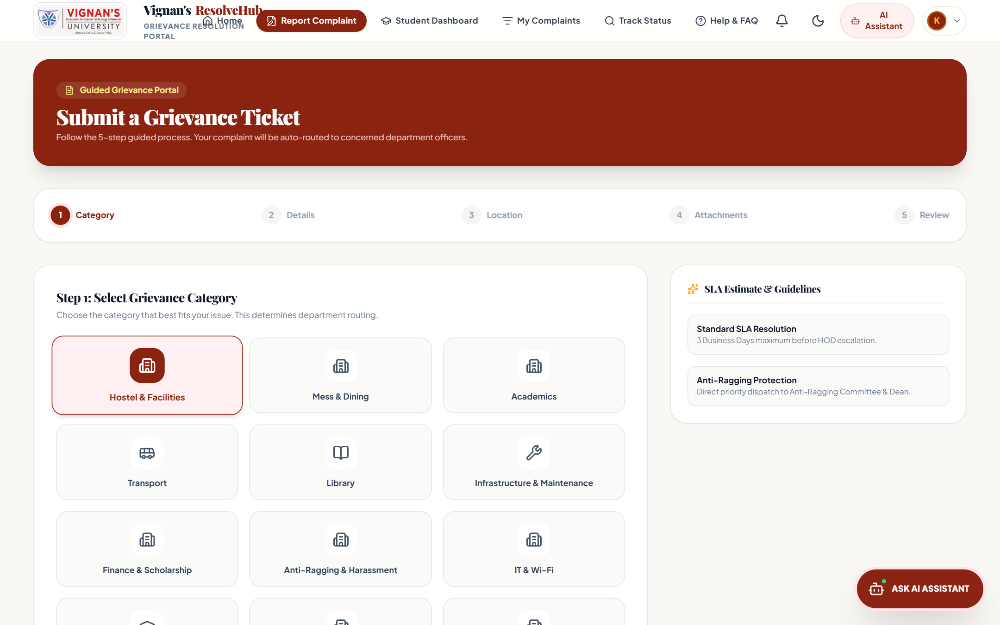
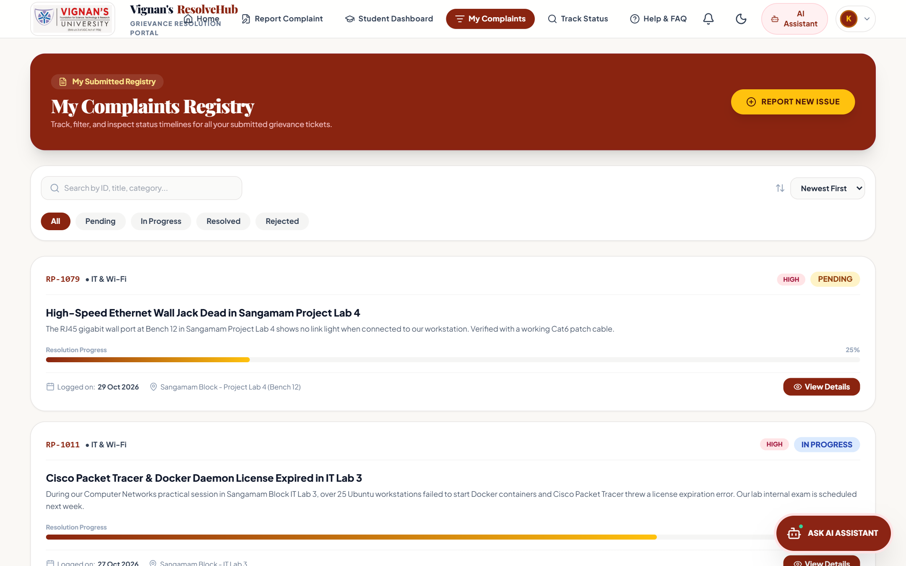
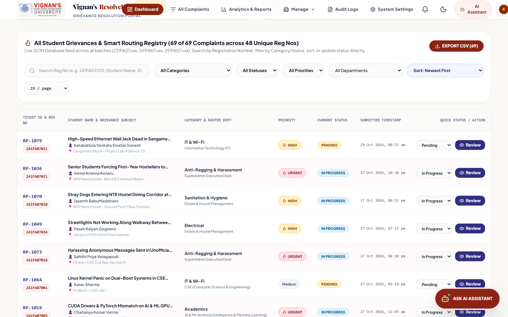
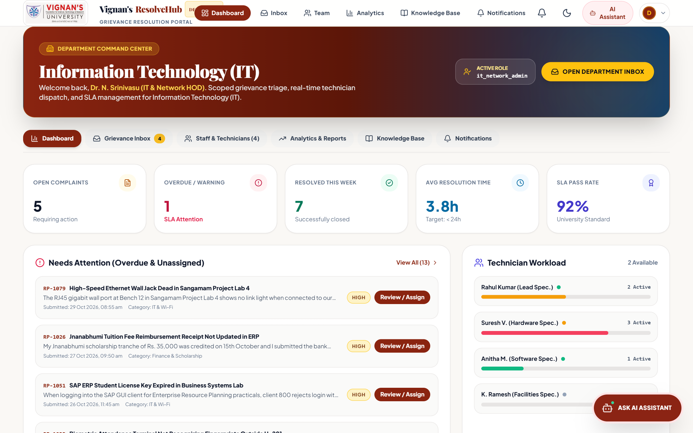
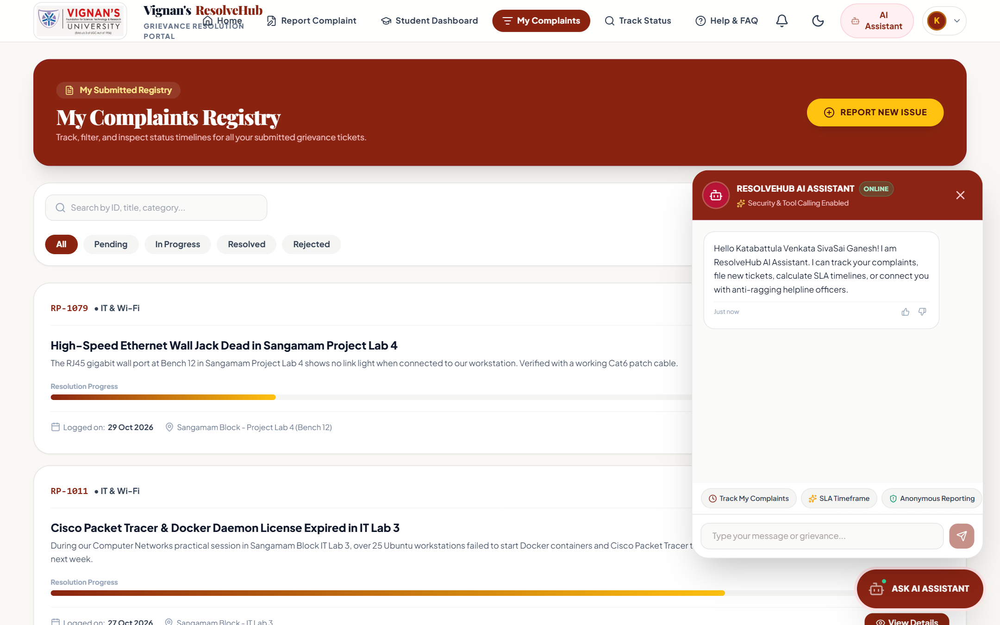
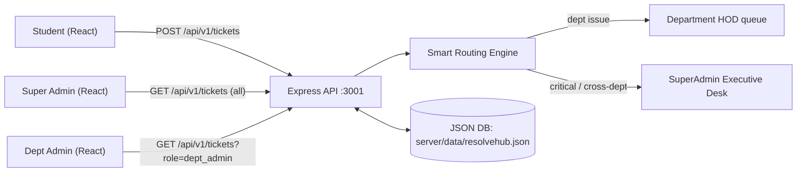

# Vignan's ResolveHub — Student Grievance Resolution Portal

ResolveHub is a role-based grievance portal for Vignan University. Students raise complaints (hostel, mess, academics, transport, IT/Wi-Fi, ragging and more). A smart routing engine sends each complaint to the right Department HOD. The Super Admin can see every complaint from every student and manage it from one dashboard.

**Repository:** https://github.com/Ganesh-commit/ResolveHub

---

## Screenshots

All screenshots below were taken from the running app with the seeded JSON database.

### 1. Landing Page


### 2. Student Login


### 3. Student Dashboard (241FA07011)


### 4. Raise Complaint Form


### 5. My Complaints


### 6. Super Admin Dashboard: all complaints from all students


### 7. Department Admin Portal (IT & Network HOD)


### 8. AI Helper


---

## Features

**Students**
- Log in with registration number. The password is the same as the registration number for seeded accounts.
- Raise complaints with a 5-step form: category → details & priority → location → attachments → review.
- Dashboard and **My Complaints** pages show only your own tickets. You can filter by status and see a progress timeline for each one.
- Two-way verification: when a HOD marks a ticket "Resolved with Proof", you can approve it or reopen it.
- AI Assistant to track complaints, check SLA timelines and get anti-ragging emergency contacts.

**Super Admin**
- Sees **every complaint from every student**, with Reg No, student name, category, routed department, priority, status and timestamp.
- Search by registration number, name, ticket ID or title.
- Filter by category, status, priority and department.
- Sort by newest, oldest, priority or Reg No.
- Pagination (15 / 25 / 50 per page, or show all).
- Quick inline status update (Pending / In Progress / Resolved / Rejected), or open the full review modal to add remarks and assign staff.
- CSV export, student signup approvals, department admin management, audit logs and analytics.
- **Smart HOD Auto-Routing Engine** button. Cross-department or critical issues (for example ragging or harassment) stay with the Super Admin's Executive Desk.

**Department Admins / HODs**
- See only the complaints routed to their department, in Kanban or table view.
- Update status, assign technicians and resolve with proof.

---

## Tech Stack

| Layer | Technology |
|---|---|
| Frontend | React 19, Vite, Tailwind CSS, lucide-react, socket.io-client |
| Backend | Node.js, Express 4, Socket.io, JWT, bcryptjs, helmet, zod |
| Database | **JSON file database:** `server/data/resolvehub.json`, mirrored to `data/resolvehub.json` |
| Tooling | puppeteer-core (screenshot/verification script), oxlint |

### How the JSON database works
`server/db.js` loads `resolvehub.json` into memory at startup. It exposes models (`Ticket`, `User`, `Staff`, `SignupRequest`, `ActivityLog`, `SystemSetting`) that support the query calls the routes use (`find`, `findOne`, `sort`, `lean`, `save`, `countDocuments`, `$or`, `$regex`, `$in` …), so the routes did not have to be rewritten.

Every write goes through a **serialized write queue**. Each write is a write-to-temp-file followed by a rename. Concurrent requests can't corrupt the file or lose data, and changes persist immediately. No MongoDB is needed.

---

## Architecture



---

## Folder Structure

```
complaint11/
├── src/                          # React frontend (Vite)
│   ├── components/               # SuperAdminDashboard, DeptAdminDashboard, StudentDashboard,
│   │                             # MyComplaintsSection, HeroSection (complaint form), LoginModal,
│   │                             # AdvancedAIChatbot, PublicLandingPage, ...
│   ├── context/ResolveHubContext.jsx   # global state, auth, complaint actions
│   └── services/api.js           # REST client (http://localhost:3001/api/v1)
├── server/                       # Express backend
│   ├── index.js                  # app, CORS, Socket.io, route mounts
│   ├── db.js                     # JSON file database engine
│   ├── data/resolvehub.json      # the database
│   ├── routes/                   # tickets.js, auth.js, aiAssistant.js, public.js
│   ├── services/                 # smartRoutingService, aiCategorizerService, slaEscalationService
│   └── scripts/
│       ├── seedJsonDatabase.js   # regenerates sample students + complaints
│       └── verifyAndCaptureScreenshots.js  # end-to-end check + README screenshots
├── data/resolvehub.json          # mirror copy of the database
└── docs/screenshots/             # README images
```

---

## Setup & Run

**Prerequisites:** Node.js 18 or newer.

```bash
git clone https://github.com/Ganesh-commit/ResolveHub.git
cd ResolveHub

# install
npm install
npm --prefix server install

# (optional) regenerate the sample JSON database
node server/scripts/seedJsonDatabase.js

# start backend (http://localhost:3001)
npm --prefix server start

# in a second terminal, start frontend (http://localhost:5173)
npm run dev
```

- If `resolvehub.json` is missing or has fewer than 60 complaints, the server seeds it automatically on startup.
- CORS accepts any `localhost` / `127.0.0.1` port, so the app works even if Vite falls back to port 5174.
- To re-run the end-to-end checks and refresh the screenshots (backend and frontend must be running): `node server/scripts/verifyAndCaptureScreenshots.js`. The script expects the frontend on port 5174. If yours is on a different port, edit `FRONTEND_URL` at the top of the script.

---

## Test Accounts

### Students
| Account | Reg No | Password |
|---|---|---|
| **Main test account** (Katabattula Venkata SivaSai Ganesh) | `241FA07011` | `241FA07011` |
| Any seeded student | e.g. `241FA07001`, `231FA07015`, `251FA07035` | **same as Reg No** |

### Admins
| Role | Username | Password |
|---|---|---|
| Super Admin | `ksaiganesh64` | `SAI@@@killer197712200611` |
| Super Admin (alt) | `superadmin` | `admin123` |
| CSE HOD | `cse_hod_admin` | `VignanCSE@2026` |
| IT & Network HOD | `it_network_admin` | `VignanIT@2026` |
| AI & ML HOD | `aiml_hod_admin` | `VignanAIML@2026` |
| Cyber Security HOD | `cyber_hod_admin` | `VignanCyber@2026` |
| ECE HOD | `ece_hod_admin` | `VignanECE@2026` |
| Robotics HOD | `robotics_hod_admin` | `VignanRobotics@2026` |
| Management (BBA/MBA/MCA) HOD | `mgmt_hod_admin` | `VignanMgmt@2026` |
| Estate & Hostel Warden | `estate_warden_admin` | `VignanEstate@2026` |

> These are demo credentials for local testing only. Change them before deploying anywhere public.

---

## Sample Data

| Item | Count |
|---|---|
| Student accounts | **48**: `241FA07001`–`241FA07040` (40), plus `231FA07004/015/027/038` (4 seniors) and `251FA07002/014/026/035` (4 freshers) |
| Complaints | **69** (68 seeded + 1 raised live during testing, `RP-1079`) |
| Unique registration numbers with complaints | **48**. Every student has at least 1 complaint, and several have 2–3 |
| `241FA07011` complaints | **7** (Pending, In Progress, Resolved and Rejected) |
| Pending signup requests | 2 (for testing the approval flow) |
| Date range | Aug – Oct 2026 |

**Categories:** Hostel & Facilities, Mess & Dining, Academics, Transport, Library, Infrastructure & Maintenance, Finance & Scholarship, Anti-Ragging & Harassment, IT & Wi-Fi, Examinations, Electrical, Sanitation & Hygiene.
**Priorities:** Low, Medium, High, Urgent.  **Statuses:** Pending, In Progress, Resolved, Rejected.

**Departments:** CSE, IT, AI & ML, Cyber Security, ECE, BI & BT, Robotics, Food Technology, Textile Industry, CS-BS, CS-DS, BBA, MBA, MCA, and Estate & Hostel Management.

---

## API Reference (main endpoints)

Base URL: `http://localhost:3001/api/v1`

| Method | Endpoint | Purpose |
|---|---|---|
| POST | `/auth/login` | Login (student Reg No or admin username) |
| GET | `/auth/me` | Current user profile |
| POST | `/auth/signup-request` | Student account request |
| GET | `/auth/signup-requests` | List requests (Super Admin) |
| GET | `/auth/students` · `/auth/admins` | Manage accounts (Super Admin) |
| GET | `/tickets` | All tickets (Super Admin). Use `?role=student&regNo=` or `?role=dept_admin&department=` to scope. Supports `category`, `status`, `priority`, `q` |
| POST | `/tickets` | Raise a complaint |
| GET | `/tickets/:id` · `/tickets/track/:id` | Ticket detail / public tracking |
| PATCH | `/tickets/:id/status` | Update status and remarks |
| PATCH | `/tickets/:id/assign` | Assign staff / department |
| POST | `/tickets/:id/notes` | Add admin remarks |
| POST | `/tickets/smart-route-all` | Run the Smart HOD Auto-Routing Engine |
| POST | `/tickets/:id/resolve-with-proof` | HOD resolves → Pending Student Verification |
| POST | `/tickets/:id/verify-resolution` | Student approves or reopens |
| POST | `/ai/chat` | AI Assistant |
| GET | `/health` | Health check |

---

## Author

**Katabattula Venkata SivaSai Ganesh** — [@Ganesh-commit](https://github.com/Ganesh-commit)
