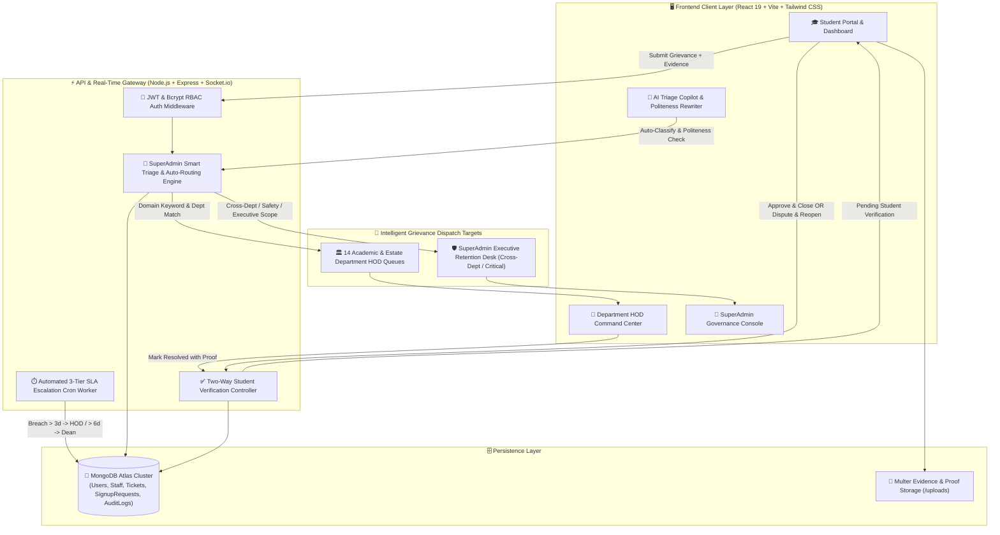
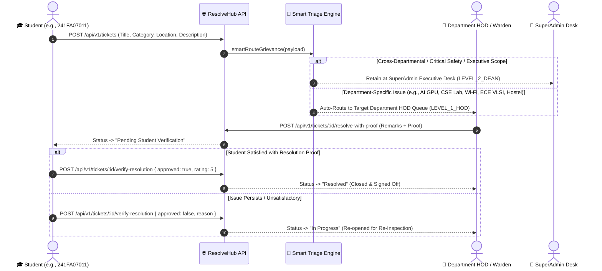
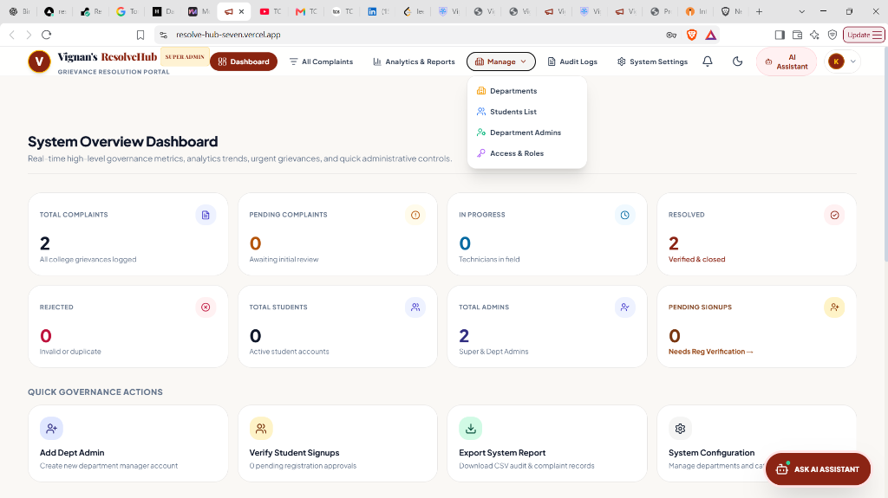
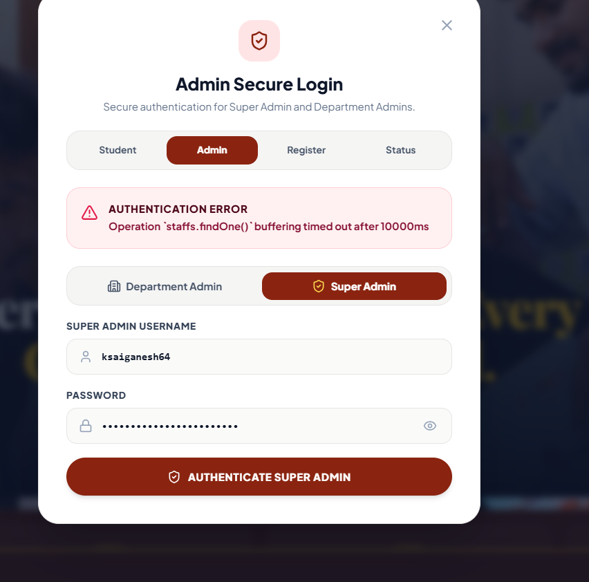
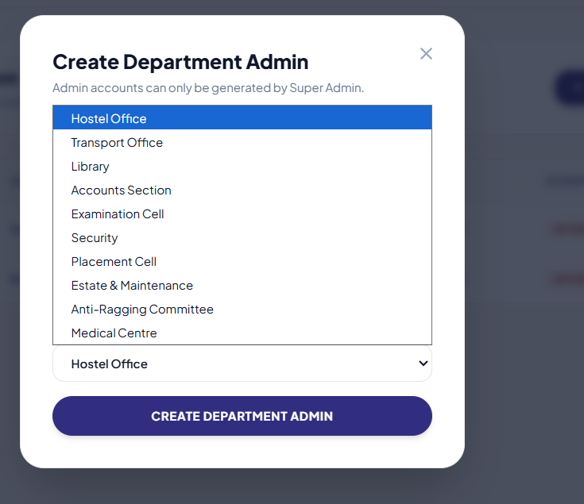
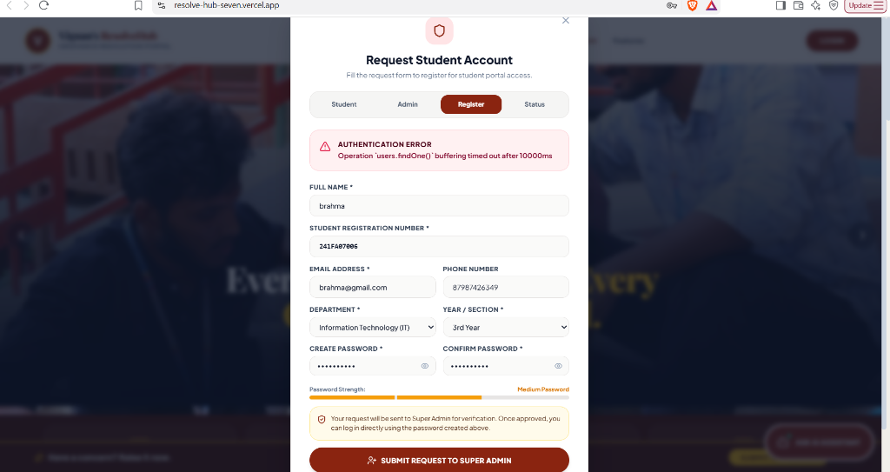
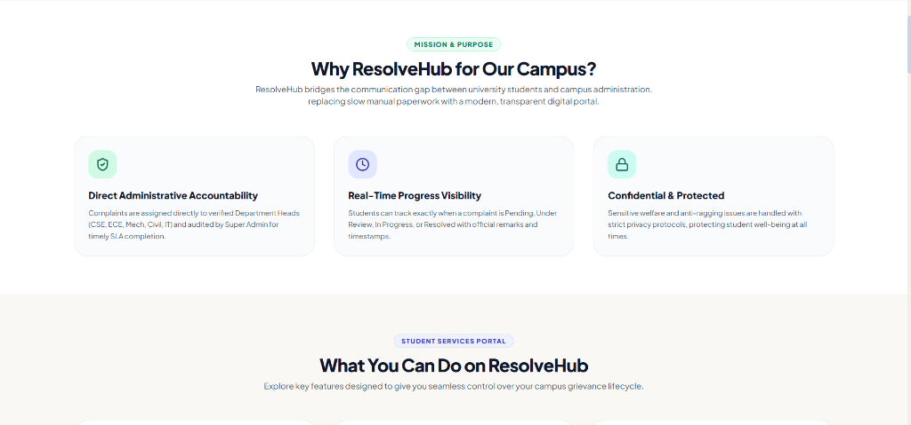
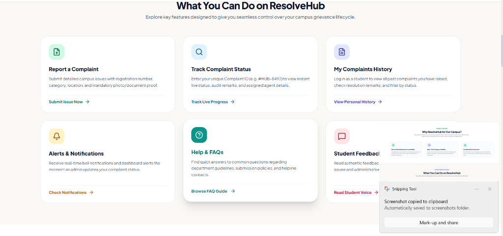

# 🎓 Vignan's ResolveHub — Enterprise University Grievance & Smart Triage Portal

[](https://resolve-hub-seven.vercel.app/)
[](https://github.com/Ganesh-commit/ResolveHub)
[](https://react.dev/)
[](https://tailwindcss.com/)
[](https://expressjs.com/)
[](https://www.mongodb.com/)
[](https://socket.io/)

> **Vignan's ResolveHub** is a production-grade, full-stack **Student Grievance Redressal & Smart Triage Governance Portal** engineered for **Vignan's Foundation for Science, Technology & Research (Vignan University)**. It unifies students, 14+ Academic & Estate Department Heads (HODs), and the Executive SuperAdmin Desk into a real-time, SLA-enforced, AI-assisted resolution ecosystem.

---

## 🌐 Live Deployment & Repository Links

- 🚀 **Live Web Application**: [https://resolve-hub-seven.vercel.app/](https://resolve-hub-seven.vercel.app/)
- 💻 **GitHub Repository**: [https://github.com/Ganesh-commit/ResolveHub](https://github.com/Ganesh-commit/ResolveHub)
- 👨‍💻 **Principal Architect & Author**: **Katabattula Venkata SivaSai Ganesh** ([@Ganesh-commit](https://github.com/Ganesh-commit))

---

## 🏗️ System Architecture & Smart Triage Flow (Mermaid.js)

### 1. High-Level Multi-Tier Architecture & Smart Routing Engine



### 2. Two-Way Resolution Verification & Lifecycle Sequence



---

## 🧠 SuperAdmin Smart Triage & Department HOD Auto-Routing Engine

Every incoming student complaint is analyzed in real time by [`server/services/smartRoutingService.js`](server/services/smartRoutingService.js):

1. **Domain-Aware Department Assignment**:
   - **CSE Lab Software / Compilers / Docker / IDEs** $\rightarrow$ Routed to **CSE HOD Admin** (`cse_hod_admin`)
   - **AI GPU Cluster / CUDA / RTX Nodes / Deep Learning** $\rightarrow$ Routed to **AI & ML HOD** (`aiml_hod_admin`)
   - **Campus Wi-Fi / Aruba APs / Routers / ERP Portal** $\rightarrow$ Routed to **IT & Network HOD** (`it_network_admin`)
   - **Cyber Security SOC / Firewall / Kali Sandbox / SIEM** $\rightarrow$ Routed to **Cyber Security HOD** (`cyber_hod_admin`)
   - **Circuit Boards / VLSI / Oscilloscopes / FPGA / Embedded** $\rightarrow$ Routed to **ECE HOD Admin** (`ece_hod_admin`)
   - **Robotic Arms / Actuators / LiDAR / ROS / 3D Printers** $\rightarrow$ Routed to **Robotics HOD** (`robotics_hod_admin`)
   - **Biotech Centrifuges / PCR / Food Processing / Textile Looms** $\rightarrow$ Routed to **BI&BT / Food Tech / Textile HODs**
   - **BBA / MBA / MCA Seminar Halls, SPSS & Case Portals** $\rightarrow$ Routed to **Management HOD** (`mgmt_hod_admin`)
   - **Hostels, Mess, RO Water, AC/Fans, Electrical, Bus Transport** $\rightarrow$ Routed to **Estate & Hostel Warden** (`estate_warden_admin`)
2. **Executive Retention & Escalation Rule**:
   - Cross-departmental policies, campus-wide safety/anti-ragging alerts, or issues beyond a single HOD's jurisdiction are flagged with `isRetainedBySuperAdmin: true` and `routingScope: 'SUPERADMIN_RETAINED'` for direct executive resolution by the **SuperAdmin**.
3. **Two-Way Verification & SLA Timers**:
   - Department HODs resolve tickets with inspection remarks/proof, transitioning the ticket to `Pending Student Verification`.
   - The submitting student can either **Approve & Close** (marking it `Resolved` with a 1–5 star rating) or **Dispute & Re-open** (returning it to `In Progress`).

---

## 🏛️ Supported University Departments (14 Core Academic + Estate & Management)

| # | Department Code | Full Official Department Name | Assigned HOD / Admin Account |
| :-: | :--- | :--- | :--- |
| 1 | **CSE** | `CSE (Computer Science & Engineering)` | `cse_hod_admin` |
| 2 | **IT** | `Information Technology (IT)` | `it_network_admin` |
| 3 | **AI&ML** | `AI & ML (Artificial Intelligence & Machine Learning)` | `aiml_hod_admin` |
| 4 | **Cyber Security** | `Cyber Security` | `cyber_hod_admin` |
| 5 | **ECE** | `ECE (Electronics & Communication Engineering)` | `ece_hod_admin` |
| 6 | **BI&BT** | `BI & BT (Bio-Informatics & Bio-Technology)` | `bibt_hod_admin` |
| 7 | **Robotics** | `Robotics` | `robotics_hod_admin` |
| 8 | **Food Tech** | `Food Technology` | `foodtech_hod_admin` |
| 9 | **Textile** | `Textile Industry` | `textile_hod_admin` |
| 10 | **CSBS** | `CS-BS (Computer Science & Business Systems)` | `csbs_hod_admin` |
| 11 | **CSDS** | `CS-DS (Computer Science & Data Science)` | `csds_hod_admin` |
| 12 | **BBA** | `BBA (Bachelor of Business Administration)` | `mgmt_hod_admin` |
| 13 | **MBA** | `MBA (Master of Business Administration)` | `mgmt_hod_admin` |
| 14 | **MCA** | `MCA (Master of Computer Applications)` | `mgmt_hod_admin` |
| 15 | **Estate & Hostels** | `Estate & Hostel Management` | `estate_warden_admin` |

---

## 🔑 Role-Based Access Control (RBAC) Credentials Table

### 👑 1. Executive SuperAdmin & Primary Student Account

| Role | Username / Reg No | Password | Scope & Permissions |
| :--- | :--- | :--- | :--- |
| 👑 **Super Admin** | `ksaiganesh64` | `SAI@@@killer197712200611` | Full executive governance, Smart Triage Auto-Routing, student signup approvals, HOD provisioning, SLA & system settings |
| 🎓 **Primary Student** | `241FA07011` | `241FA07011` | Pre-seeded with **20 diverse, realistic complaints** across Academic, Hostel, IT/Lab, Transport, Mess, Electrical & Library |
| 🎓 **Sample Student Range** | `241FA07012` – `241FA07200` | `<Same as Reg No>` | 189 active student accounts across all 14 departments with multi-department analytical grievance data |

### 🏢 2. Department HOD & Estate Warden Credentials

| Department / Administrative Role | Username | Password | Jurisdiction Scope |
| :--- | :--- | :--- | :--- |
| **CSE HOD Admin** | `cse_hod_admin` | `VignanCSE@2026` | CSE Labs, Compilers, Cloud & Programming Infrastructure, CSE Academics |
| **IT & Network HOD** | `it_network_admin` | `VignanIT@2026` | Campus Wi-Fi, Optical Fiber Switches, ERP/LMS Portals, IT Department |
| **AI & ML HOD** | `aiml_hod_admin` | `VignanAIML@2026` | AI Research Center, NVIDIA GPU Clusters, Deep Learning Labs & Academics |
| **Cyber Security HOD** | `cyber_hod_admin` | `VignanCyber@2026` | SOC Lab, VLAN Firewalls, Kali Sandboxes, SIEM & Network Security |
| **ECE HOD Admin** | `ece_hod_admin` | `VignanECE@2026` | VLSI, Embedded Systems, Oscilloscopes, PCB & Communication Labs |
| **Robotics HOD** | `robotics_hod_admin` | `VignanRobotics@2026` | Robotics & Mechatronics Lab, Actuators, LiDAR, Drones & 3D Printers |
| **Management (BBA/MBA/MCA) HOD** | `mgmt_hod_admin` | `VignanMgmt@2026` | BBA, MBA, and MCA Academic Blocks, Seminar Halls & Analytics Labs |
| **Estate & Hostel Warden** | `estate_warden_admin` | `VignanEstate@2026` | Boys/Girls Hostels, Mess & Canteens, RO Water, Electrical, HVAC & Bus Transport |
| **BI & BT HOD** | `bibt_hod_admin` | `VignanBIBT@2026` | Bio-Informatics & Bio-Technology Molecular Labs & Equipment |
| **Food Technology HOD** | `foodtech_hod_admin` | `VignanFood@2026` | Food Processing Pilot Plants, Pasteurization & Quality Labs |
| **Textile Industry HOD** | `textile_hod_admin` | `VignanTextile@2026` | Weaving Studio, Spinning Units & Fabric Testing Labs |
| **CSBS HOD** | `csbs_hod_admin` | `VignanCSBS@2026` | Computer Science & Business Systems Enterprise ERP Labs |
| **CSDS HOD** | `csds_hod_admin` | `VignanCSDS@2026` | Computer Science & Data Science Big Data / Spark Clusters |

---

## 📸 Visual Interface Gallery

### 🏛️ 1. Super Admin Governance Console & Manage Navigation


### 🌐 2. Full-Width Edge-to-Edge Campus Grievance Portal


### 📝 3. Student Registration & Account Verification Hub


### 📎 4. Evidence Attachments & Image Lightbox Preview


### 📑 5. Smart Grievance Submission Form


### ⏱️ 6. Student Dashboard & Live SLA Resolution Stepper


### 📊 7. Real-Time Department Analytics & Heatmap Reports


---

## 📡 Complete REST API Reference (`/api/v1`)

| Method | Endpoint | Access Role | Description |
| :---: | :--- | :--- | :--- |
| `POST` | `/api/v1/auth/login` | Public | Authenticates SuperAdmin, Department HOD, or Student (`regNo` / `username` + `password`) |
| `GET` | `/api/v1/auth/me` | Authenticated | Verifies active JWT session and returns user profile & role |
| `POST` | `/api/v1/auth/signup-request` | Public | Submits a new student registration request for SuperAdmin verification |
| `GET` | `/api/v1/auth/signup-requests` | SuperAdmin | Lists all student signup requests (`PENDING`, `APPROVED`, `REJECTED`) |
| `POST` | `/api/v1/auth/signup-requests/:id/approve` | SuperAdmin | Approves student registration request and provisions active account |
| `POST` | `/api/v1/auth/signup-requests/:id/reject` | SuperAdmin | Rejects student signup request with an audit reason |
| `GET` | `/api/v1/auth/students` | SuperAdmin | Lists all active student accounts (`241FA07011` – `241FA07200`) |
| `GET` | `/api/v1/auth/admins` | SuperAdmin | Lists all Department HOD & Admin accounts |
| `POST` | `/api/v1/auth/admins` | SuperAdmin | Provisions a new Department HOD / Admin account |
| `GET` | `/api/v1/tickets` | Scoped RBAC | Returns all tickets (SuperAdmin), HOD-scoped tickets (`dept_admin`), or student's own tickets (`student`) |
| `POST` | `/api/v1/tickets` | Student / Admin | Creates a new grievance ticket and runs the **Smart HOD Auto-Routing Engine** |
| `POST` | `/api/v1/tickets/smart-route-all` | SuperAdmin | Batch-executes the Smart Triage & HOD Auto-Routing Engine across pending tickets |
| `PATCH` | `/api/v1/tickets/:id/smart-route` | SuperAdmin | Routes a ticket to a specific HOD or retains it at the SuperAdmin Executive Desk |
| `POST` | `/api/v1/tickets/:id/resolve-with-proof` | Dept HOD / Admin | Marks a ticket as `Pending Student Verification` with inspection remarks & proof |
| `POST` | `/api/v1/tickets/:id/verify-resolution` | Student | Two-Way Verification: Student approves (`Resolved`) or disputes (`In Progress` + Reopen) |
| `PATCH` | `/api/v1/tickets/:id/status` | Dept HOD / Admin | Updates ticket status, timeline stage, and official response remarks |
| `PATCH` | `/api/v1/tickets/:id/assign` | Dept HOD / Admin | Assigns a field specialist or department technician to the ticket |
| `POST` | `/api/v1/tickets/run-sla-escalation` | System / Admin | Triggers the 3-tier SLA escalation worker (`LEVEL_0` $\rightarrow$ `LEVEL_1_HOD` $\rightarrow$ `LEVEL_2_DEAN`) |
| `POST` | `/api/v1/ai/chat` | Student / Admin | Conversational AI Triage Copilot with emergency keyword detection & tool execution |
| `POST` | `/api/v1/ai/smart-suggest` | Student | Real-time AI category, priority, SLA target, and politeness rewrite suggestions |

---

## 🚀 Local Setup & Installation Guide

### Prerequisites
- **Node.js** `v18+` and **npm**
- **MongoDB** (MongoDB Atlas URI or local `mongodb://127.0.0.1:27017/resolvehub`)

### 1. Clone the Repository & Install Dependencies
```bash
git clone https://github.com/Ganesh-commit/ResolveHub.git
cd complaint11

# Install frontend dependencies
npm install

# Install backend dependencies
cd server
npm install
cd ..
```

### 2. Configure Environment Variables (`server/.env`)
Create `server/.env` (or copy `server/.env.example`):
```env
PORT=3001
MONGODB_URI=mongodb://127.0.0.1:27017/resolvehub
JWT_SECRET=vignan_resolvehub_super_secret_jwt_key_2026
SUPERADMIN_USERNAME=ksaiganesh64
SUPERADMIN_PASSWORD=SAI@@@killer197712200611
DEMO_STUDENT_REG_NO=241FA07011
DEMO_STUDENT_PASSWORD=241FA07011
```

### 3. Run the Comprehensive Database Seeder
Seeds all 14+ Department HOD accounts, preserves `241FA07011` and `SuperAdmin`, seeds student range `241FA07012`–`241FA07200`, injects 20 diverse complaints for `241FA07011`, and seeds multi-department analytical tickets:
```bash
npm --prefix server run seed
```

### 4. Launch Backend & Frontend Servers
```bash
# Terminal 1: Start Express + Socket.io Backend (Port 3001)
npm --prefix server start

# Terminal 2: Start Vite + React Frontend (Port 5173 / 5174)
npm run dev
```

---

## 👨‍💻 Author & Credits

**Katabattula Venkata SivaSai Ganesh**  
- **GitHub**: [@Ganesh-commit](https://github.com/Ganesh-commit)  
- **Institution**: Vignan's Foundation for Science, Technology & Research (Vignan University)  
- **Project**: *Vignan's ResolveHub — Enterprise Student Grievance Resolution & Smart Triage Portal*

---

## 📜 License

Copyright © 2026 **Katabattula Venkata SivaSai Ganesh** (`@Ganesh-commit`). Built for **Vignan University**. All rights reserved.
